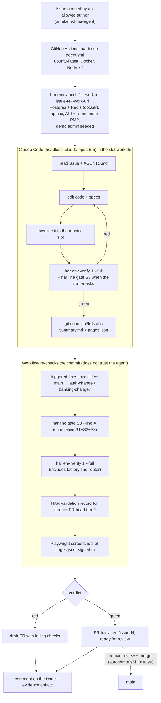

# HAR issue agent

Opening a GitHub issue starts the agent. Claude Code picks the issue up in a
HAR slot on a GitHub-hosted runner, makes the change, and proves it. The
result is a pull request whose body holds the proof: full HAR verification on
the exact commit, the factory lines the diff triggered, and screenshots of the
running app.

This is tier 1 of the [factory setup research](https://github.com/os-factory/research/blob/main/topics/005-factory-local-setup/README.md):
**no servers.** GitHub provides the trigger, queue and runner. Claude Code
does the work. HAR provides the environment and the gate.

## How it works

| Piece                                                           | File                                                                                       |
| --------------------------------------------------------------- | ------------------------------------------------------------------------------------------ |
| Trigger, slot, agent, re-check, publish                         | [`../workflows/har-issue-agent.yml`](../workflows/har-issue-agent.yml)                     |
| Agent brief (rules + issue)                                     | [`prompt.md`](prompt.md), filled by [`scripts/build-prompt.mjs`](scripts/build-prompt.mjs) |
| Readable agent log from `stream-json`                           | [`scripts/stream-log.mjs`](scripts/stream-log.mjs)                                         |
| Lines the diff triggers (same routing as `factory-line-router`) | [`scripts/triggered-lines.mjs`](scripts/triggered-lines.mjs)                               |
| Signed-in screenshots of the slot app                           | [`scripts/screenshot.mjs`](scripts/screenshot.mjs)                                         |
| PR body + verdict from HAR evidence                             | [`scripts/proof-report.mjs`](scripts/proof-report.mjs)                                     |

## Why the PR can be trusted

1. **The agent follows the same contract as a local agent.** `AGENTS.md` asks
   for `verify --full` and the factory lines. The brief adds the unattended
   rules: no push, no PR, no changes to `.har/` or `.github/`, no skipped tests.
2. **The workflow doesn't take the agent's word for it.** After the agent
   stops, the workflow runs the gates of every line the diff triggers itself,
   then `har env verify --full`.
3. **Proof is bound to the commit.** HAR records a validation per git tree
   (`.har/validations/<tree>.json`). The verdict is green only if a passing
   _full_ validation exists for the tree of the commit pushed to the PR
   branch.
4. **Red never looks green.** A red verdict opens a draft PR, fails the
   workflow run, and says so on the issue.
5. **The agent has no GitHub credentials.** Checkout doesn't persist the token,
   and `GH_TOKEN` is empty during the agent step. Pushing and opening the PR
   are deterministic workflow steps.

## No CI on these PRs

HAR already runs the checks CI would run (typecheck, Jest, ESLint, Prettier,
API health, agent-usable smoke, Prisma drift, factory lines), and it runs them
against a live app. GitHub never starts other workflows for events created
with `GITHUB_TOKEN`, so `build-code.yml` doesn't run on the bot's PRs. HAR's
verdict in the PR body is the gate.

## Where the proofs live

- **PR body:** verify stage table, validation id, tree identity, factory-line
  table, screenshots, agent turns and cost.
- **`har-agent-proofs` branch:** `issue-<n>/run-<id>-<attempt>/` holds the
  screenshots and JSON evidence. The PR embeds the screenshots from here,
  pinned to a commit.
- **`har-evidence-issue-<n>` run artifact (30 days):** HAR run records
  (`.har/runs`), validations, stage reports and the full agent transcript.

## Setup

1. Add the repository secret `ANTHROPIC_API_KEY`.
2. Settings → Actions → General → Workflow permissions: **Read and write**, and
   tick **Allow GitHub Actions to create and approve pull requests**.
3. Optional repository variables:

| Variable                   | Default           | Meaning                                                                |
| -------------------------- | ----------------- | ---------------------------------------------------------------------- |
| `HAR_AGENT_AUTHORS`        | `["antoineFrau"]` | JSON list of logins whose issues, labels or dispatches start the agent |
| `HAR_AGENT_MODEL`          | `claude-opus-5-5` | Claude model                                                           |
| `HAR_AGENT_MAX_BUDGET_USD` | `40`              | Hard spend cap per run (`claude --max-budget-usd`)                     |

## Use

- Open an issue as an allowed author. The title and body are the prompt.
- Re-run an issue by adding the `har-agent` label, or with
  `gh workflow run har-issue-agent.yml -f issue_number=<n>`. A re-run updates
  the same `har-agent/issue-<n>` PR.
- Opt an issue out by opening it with the `har-agent:skip` label.

## Limits

- **Trust.** Only allowed authors trigger the agent, because issue text is a
  prompt-injection vector. The agent runs with `bypassPermissions` on a
  throwaway runner that holds only the Anthropic key.
- **Runner size.** A standard `ubuntu-latest` runner (4 vCPU, 16 GB) runs one
  slot. Each issue gets its own runner, so issues run in parallel.
- **Time.** One run takes about 25–90 minutes. Most of that is `npm ci`, slot
  launch and the full Jest/ESLint suite, plus the agent's own iterations.
