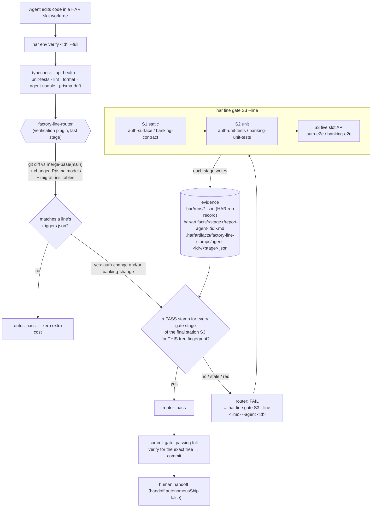

# Factory lines: auth and banking

Ghostfolio has two areas where a regression costs more than a red test:
**authentication** (who you are, what you may do) and **banking** (cash
accounts, balances, transfers, platforms). Each has a HAR
[factory line](https://harproject.dev/docs/guides/factory-lines/): a
three-station program with a cumulative gate. A **router** on
`har env verify --full` makes the line mandatory as soon as a change enters its
territory.

| Line | Territory (`triggers.json`) | S1 static | S2 unit | S3 live, on the slot |
|---|---|---|---|---|
| [`auth-change`](auth-change/README.md) | auth/oauth/api-keys/accesses/users endpoints, guards, decorators, middlewares, impersonation, `permissions.ts`, `scopes.ts`, client auth pages; Prisma `User`, `Access`, `ApiKey`, `AuthDevice` | `auth-surface` | `auth-unit-tests` | `auth-e2e` |
| [`banking-change`](banking-change/README.md) | accounts/platforms endpoints and services, balance DTOs/validators, account UI; Prisma `Account`, `AccountBalance`, `Platform`, `TagsOnAccounts` | `banking-contract` | `banking-unit-tests` | `banking-e2e` |

## How it works



Three HAR rules shape this design:

- **Line stages never join `verificationStages`.** `har line add` refuses,
  and `har env doctor` fails otherwise. `verify --full` therefore stays as fast
  as before for the ~90% of changes outside both territories.
- **A check that must gate every verify belongs in a verification plugin.**
  So only the cheap router is on verify. It runs the expensive line stages
  only when needed.
- **`gate.cumulative: true`.** `har line gate S3` runs every stage tagged
  `fromStation` S1, S2 or S3, so a later station can never skip an earlier
  question.

### Gate stamps: binding the gate to the exact tree

`har line gate` alone answers "was the gate green at some point?". The router
needs "is it green for **this** code?". So every line stage writes a stamp to
the main checkout's `.har/artifacts/factory-line-stamps/agent-<id>/<stage>.json`:

```json
{ "stageId": "auth-e2e", "line": "auth-change", "status": "pass",
  "tree": "<git write-tree of the work dir incl. untracked>", "head": "<sha>", "finishedAt": "…" }
```

The router recomputes the fingerprint and compares. If one byte changes after
the gate ran, the router reports `stale`. The stamp sits beside the HAR run
record (`.har/runs/…_<stage>_agent-<id>.json`), which stays the source of truth
for `har line status`.

## What each station asks

### auth-change

| Station | Stage | Questions |
|---|---|---|
| S1 Map the auth surface | `auth-surface` | Does `app.module.spec` still hold in Jest `--ci` mode (unauthenticated routes == `PUBLIC_ROUTES`, route security snapshot unchanged)? Is any route **weaker** than on the merge base: lost guard, permission or scope, became public, newly allowed during impersonation, lost value redaction? Did any role **gain** a permission? Does the diff add `ignoreExpiration: true`, alg `none`, a hard-coded secret, a token in the URL, `jwt.decode`, a logged credential, `Math.random()` in token code, or disabled rate limiting? |
| S2 Unit-prove | `auth-unit-tests` | Do all specs in the auth territory pass (guards, decorators, middlewares, OIDC/OAuth helpers, bearer token, impersonation, scopes, route inventory)? Does an auth source change ship with a spec change? |
| S3 Attack the live slot | `auth-e2e` | JWT forgery matrix (wrong secret, alg none, expired, tampered payload, unknown user), each with a positive control. Wrong/empty security token rejected. Token rotation kills the old token. **Every** route behind `AuthGuard('jwt')` (120) rejects anonymous and forged callers. Every `AuthGuard('api-key')` route (7) rejects missing or bogus keys. A second user cannot impersonate, read admin data or reach the admin API without a grant. |

### banking-change

| Station | Stage | Questions |
|---|---|---|
| S1 Ledger contract | `banking-contract` | Route policy: account, balance and transfer routes need JWT + permission + impersonation + scope guards; mutations need a permission and are blocked during impersonation; reads redact values; platform routes need JWT + permission. Ledger schema invariants: `Account` keyed by `(id, userId)`, balances owned and cascading, one balance per account per day, required value, unique platform URL. Migration safety: applied migrations immutable; DROP/TRUNCATE/DELETE/type change/data rewrite on a banking table must be acknowledged. |
| S2 Unit-prove | `banking-unit-tests` | Do all specs in the banking territory pass (account helper, ROAI/ROI cash calculators, balance-date validator)? Does a banking source change ship with a spec change? |
| S3 Prove the ledger live | `banking-e2e` | Transfers conserve money exactly (incl. 3 × 0.1). Overdraw, zero, negative, non-numeric, self, unknown-account transfers are rejected **and** leave balances untouched. One balance per day (upsert), no future dates. IDOR: a second user can't read, pull, push, rename, append, delete balances or delete the account. Deleting an account cascades its balances. |

## Running it

```bash
har line status                                   # both lines, per-station progress from run records
har line gate S3 --line auth-change --agent 3     # cumulative gate (S1+S2+S3); slot must be launched
har line gate S1 --line banking-change --agent 3  # just the static station, fast
har env verify 3 --full                           # router fails if a triggered line isn't green for this tree
node --test .har/plugins/factory-line-router/test/*.test.mjs   # self-test of the shared library
```

Reports for humans are at `.har/artifacts/<stage>/report-agent-<id>.md`.
Machine results are at `.har/artifacts/<stage>/result-agent-<id>.json`.
`HAR_LINE_BASE=<ref>` changes the diff base (default `main`).

## Intentional weakenings

Some changes are meant to loosen something, such as a new public route or a
dropped column. They go into a reviewed ledger, never into a bypass:

- `auth-change/security-acks.json`: `{"subject": "GET /foo", "change": "new route without authentication", "reason": "…"}`
- `banking-change/ledger-acks.json`: `{"subject": "prisma/migrations/…/migration.sql", "change": "DROP COLUMN on \"AccountBalance\"", "reason": "…"}`

The S1 report prints the exact JSON to paste. The ledgers sit inside their
line's territory, so adding an entry re-triggers that line and shows up in
review.

## Growing the ratchet

When a review finds a new class of defect, add a check to the stage of the
station where it first becomes askable (or a new stage tagged `fromStation`).
Never remove an earlier one. After editing a line or the plugin, re-apply:

```bash
har line add auth-change --force && har line add banking-change --force
har env add-plugin factory-line-router --force
```

## Files

```text
.har/
├── lines.json                          # HAR install ledger (har line add)
├── lines/
│   ├── README.md                       # this file
│   ├── auth-change/
│   │   ├── line.json / line.manifest.json   # program + bundle (contractVersion 1)
│   │   ├── triggers.json               # territory: paths, Prisma models, specs (read by the router)
│   │   ├── security-acks.json          # reviewed weakenings
│   │   └── stages/auth-{surface,unit-tests,e2e}.{sh,mjs}
│   └── banking-change/
│       ├── line.json / line.manifest.json
│       ├── triggers.json
│       ├── ledger-acks.json
│       └── stages/banking-{contract,unit-tests,e2e}.{sh,mjs}
├── plugins/factory-line-router/        # verification plugin: router stage + shared lib
│   ├── template.manifest.json
│   ├── stages/factory-line-router.{sh,mjs}
│   ├── stages/lib/factory-line.mjs     # stage contract, diff/territory, stamps, Jest, HTTP/JWT helpers
│   └── test/factory-line.test.mjs
└── stages/                             # installed copies (written by har line add / add-plugin)
```
